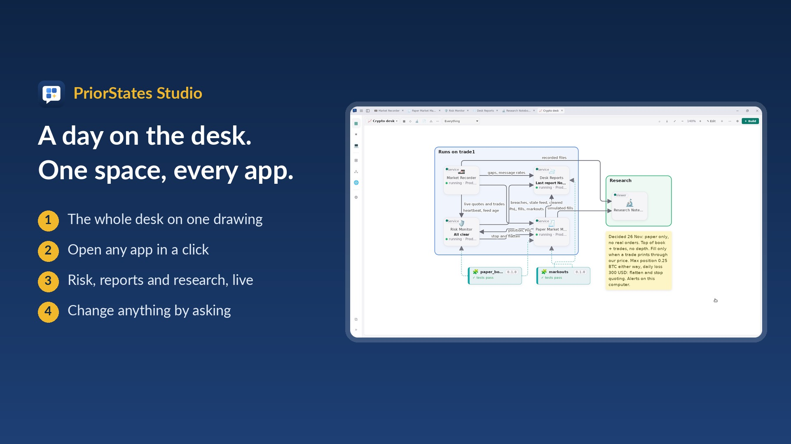
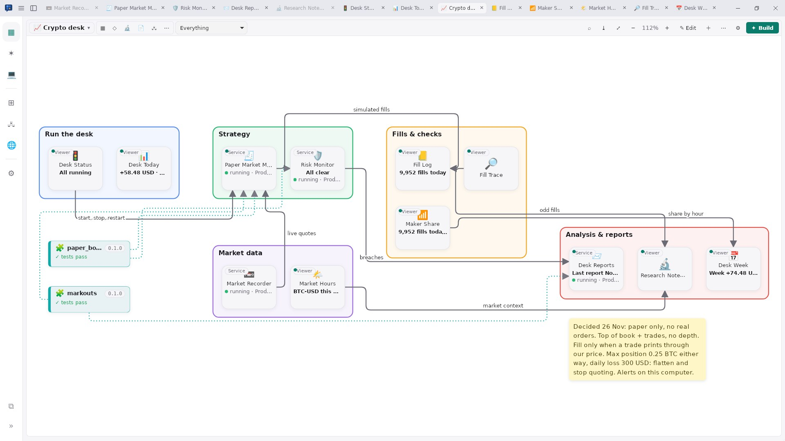

# Crypto desk

A paper trading desk for Coinbase, built in [PriorStates Studio](https://priorstates.com/hub.html) by asking for it.
Open it in your own Studio, point it at your own server, and change it by asking.

**Slides:** [how this desk was built, run and shared in Studio](slides/crypto_desk_deck.pdf) (24 pages, PDF).

[](https://priorstates.com/assets/qt/crypto-desk-day-v1.mp4)

**[Watch a day on the desk](https://priorstates.com/assets/qt/crypto-desk-day-v1.mp4)** (2 min, narrated): the whole
desk on one drawing, each app opened from it, a test report sent, a study run, and a change made by asking. The file
is also in [`video/`](video/crypto-desk-day.mp4).

**Paper trading only.** No exchange account, no API key, and no code that sends an order. The desk reads Coinbase's
public market data feed and simulates its own fills.

## What is in it

| App | Runs | What it does |
|---|---|---|
| 📼 Market Recorder | service on your server | Records BTC-USD and ETH-USD top of book and trades from Coinbase's public feed, around the clock, with gap detection, a disk cap and a live socket for the other services. |
| 🧾 Paper Market Maker | service on your server | Quotes one bid and one ask around the mid on BTC-USD, fills them when a trade prints through the price, and logs fills, position, PnL and markouts (1 / 5 / 30 s). |
| 🛡️ Risk Monitor | service on your server | Independent of the strategy: rebuilds position and day PnL from the fills, checks position and loss limits and feed staleness, and stops and flattens the paper strategy on a breach. |
| 📨 Desk Reports | service on your server | Daily and weekly reports (PnL, fills, markouts by side, risk events, feed gaps, disk), plus an alert when a limit is hit or a feed goes stale and again when it clears. By email (SMTP) and Slack (webhook). |
| 🔬 Research Notebook | in Studio | Copies the recorded files and the paper fills from the server over ssh (read only) and studies spreads, volatility, and how prices move after trades. |
| 🚦 Desk Status | in Studio | Each service's health, running time, restarts and last heartbeat on one page, with a button to open its app. |
| 📊 Desk Today | in Studio | The desk on one screen: today's PnL with its trend, position, BTC-USD and ETH-USD mids, fills, the risk state and the feed's age. |
| 📒 Fill Log | in Studio | Every simulated fill, newest first, for today or the last 7 days, with totals, a filter by side and Export CSV. |
| 🔎 Fill Trace | in Studio | The story of one fill: the mid before it and 1, 5 and 30 s after, what the maker was quoting, and risk events within a minute. |
| 📶 Maker Share | in Studio | Simulated fills hour by hour today, against the market's trading where the recorder publishes it. |
| 📅 Desk Week | in Studio | The last 7 days, one row per day: PnL, fills, average markouts, risk breaches and stale-feed events. |
| 🌤️ Market Hours | in Studio | BTC-USD and ETH-USD hour by hour: average spread, realized volatility and trade rate, beside the desk's PnL. |

Each service app also has a page in Studio for status, settings and charts. Every service uses only the Python
standard library. The seven apps after the Research Notebook only read the services' data through Studio, so there is
nothing to deploy for them.



## Open it in Studio

1. Download and install [PriorStates Studio](https://priorstates.com/hub.html) for your computer.
2. In Studio: **Add a space** → **Keep it: From a git repository** → Repository address:
   `https://github.com/priorstates/crypto-desk` → **Clone and open**.
3. The space opens with its drawing: twelve apps in five groups (run the desk, strategy, fills and checks, analysis and
   reports, market data), how data flows between them, and the decisions made so far.

Until the services run on a server, the service apps' pages show sample data.

## Run it on your server

The services expect a Linux server you can reach over ssh with `python3` installed. They call it
`trade1`. Either add that name to your `~/.ssh/config`:

```
Host trade1
    HostName <your server>
    User <your user>
```

or ask the space's Build: *"Use my server `myhost` instead of trade1."*

Then deploy the four services, Market Recorder first, then Paper Market Maker, Risk Monitor and Desk Reports. Open
**Services**: each one is listed with **Deploy to…** (Studio 0.5.83 or later), because every app carries how to deploy
it in its `deploy.json`. Press it, name your server (it suggests `trade1`), check what it will copy and run there, and
press **Deploy**. Studio copies the app's `remote/` folder to the server, starts the service, and from then on Services
has **Deploy**, **Start**, **Stop**, **Check** and **Log** for it; the app's page fills in within a few seconds. Mark the
server as production in Studio, and every deploy and stop asks you first.

With an older Studio, open each app, press **Build**, and say: *"Deploy this as a service on trade1."* (or your own
server's name).

**Reports and alerts:** open Desk Reports → Settings, fill in your SMTP server and address (or a Slack webhook), and
press **Send a test report now**. The password and the webhook are written to a private file on the server (mode 600),
never into the app's code or this repository.

## Change it by asking

Studio's AI works on these apps with you. Some things to try:

- *"Record SOL-USD too."*
- *"Only fill a paper quote on a trade that prints at least 250 ms after the quote was placed."*
- *"Add a max order-rate limit to Risk Monitor."*
- *"Send the daily report at 17:00 New York time instead of 21:00 UTC."*
- In **Discuss**: *"Why do the sells lose more than the buys?"*, with the fills and markouts in front of it.

You can also click 💬 on any part of an app's page, write what should change there, and press **Do it**, or ✋ to edit
text by hand.

## How the repository is laid out

```
studio-space.json   the space: name, icon, groups and the drawing
NOTES.md            the space's notes (its goal)
slides/, video/     the deck and the video of the desk
apps/<id>/          one folder per app: plugin.json, index.html, js/, css/, and remote/ for the service code;
                    deploy.json says how a service app is deployed (folder, service, settings form)
                    _components/ are pinned copies of shared parts (paper_book, markouts)
```

Each person's own data (`apps/*/data/`) stays out of git. Your chats and discussions stay in Studio on your computer.
To share your changes with your team, keep the space in your own repository and commit from Studio's ⎇ button.

## License and disclaimer

The desk's code is licensed under the [Apache License 2.0](LICENSE). PriorStates Studio itself is a separate product
with its own terms.

This is example software for learning and research. It is provided as is, with no warranty. It is not investment
advice, and it does not trade.
